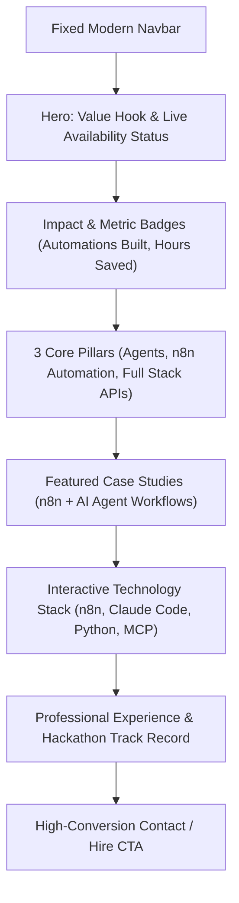

# Portfolio Redesign Blueprint: AI Agent & Automation Engineer

> **Objective**: Transform Sandhosh's portfolio from a student/intern showcase into a high-converting, professional **AI Agent & n8n Automation Engineer** portfolio that commands premium client contracts and high-impact engineering roles.

---

## 1. Professional Persona & Positioning

### The Core Narrative
* **Before**: "Engineering student specializing in AI & Data Science looking for internships."
* **After**: **"AI Agent Developer & n8n Automation Architect"** — an engineer who bridges Large Language Models (LLMs) with real business operations through autonomous agents, Claude Code toolchains, and resilient n8n pipelines.

### The Value Proposition
> *"I turn complex, repetitive manual processes into autonomous, self-healing agentic workflows. From custom tool-calling agents with Claude Code to enterprise n8n integration pipelines, I engineer systems that work 24/7."*

---

## 2. Architecture & Section Breakdown



---

## 3. Detailed Section-by-Section Redesign

### Section 1: Navigation & Header
* **Branding**: `Sandhosh.ai` / `Sandhosh Gowravan`
* **Nav Links**:
  * `#expertise` — What I Build
  * `#agents-n8n` — Workflows & Agents
  * `#projects` — Case Studies
  * `#skills` — Stack & Tools
  * `#experience` — Career Journey
  * `#contact` — Work With Me
* **Quick Action**: Direct link to resume / GitHub / LinkedIn.

---

### Section 2: Hero Section (The 5-Second Hook)

#### Copywriting
* **Pre-headline**: `<div class="status-pill"><span class="dot online"></span> Available for AI Agent & n8n Automation Projects</div>`
* **Headline**:
  ```html
  <h1>
    Architecting <span class="gradient-text">Autonomous AI Agents</span><br>
    & Production <span class="gradient-text">n8n Automations</span>
  </h1>
  ```
* **Sub-headline**:
  > *"Specialized in deploying resilient multi-step workflows, Claude Code-driven agentic loops, and custom API integrations that automate mission-critical operations."*
* **Primary CTAs**:
  1. `[ Explore Workflows ↓ ]` (Scrolls to Case Studies)
  2. `[ Let's Automate Together ]` (Mailto / Calendar link)
* **Visual Element**:
  * Clean profile photograph framed with a subtle ambient purple glow (`#c778dd`).
  * Floating quick-stat chips:
    * `⚡ n8n Specialist`
    * `🤖 Claude Code & MCP`
    * `🐍 Python & FastAPIs`

---

### Section 3: Value Metrics Bar (Instant Credibility)

A 4-column horizontal banner between Hero and Projects:
1. **50+ Workflows Automated**: Production n8n scenarios with webhooks, error handlers, and sub-workflows.
2. **Autonomous Tool Calling**: Deep expertise with Claude Code, MCP (Model Context Protocol), and function calling.
3. **Multi-Model Orchestration**: Smart fallbacks across Anthropic Claude, OpenAI, and Gemini models.
4. **Hackathon Proven**: Winner & finalist at OpenAI to Z Global Challenge, IBM Qiskit Quantathon, and HackZion.

---

### Section 4: Three Core Expertise Pillars

Replace generic college descriptions with 3 high-value service pillars:

#### 1. Autonomous AI Agents & Tool Calling
* **Description**: Designing agents that can read environments, make decisions, execute multi-step CLI/browser/API tools, and self-correct on failure.
* **Keywords**: *Claude Code, Agentic Loops, ReAct Pattern, Function Calling, Prompt Engineering, MCP Servers.*

#### 2. Enterprise n8n Workflow Automation
* **Description**: Building end-to-end automated pipelines that connect CRMs, databases, messaging channels (Slack/WhatsApp), and internal APIs with enterprise error handling.
* **Keywords**: *n8n Self-Hosted, Webhooks, AI Agent Nodes, Vector Store Integrations, JSON Transformations.*

#### 3. Backend & Production Tooling
* **Description**: Writing solid Python & Node.js backends, custom API middleware, and secure webhooks to feed automation engines.
* **Keywords**: *Python, FastAPI, REST APIs, PostgreSQL, Redis, Docker, Git.*

---

### Section 5: Featured Projects (Case Studies)

Highlight real-world problem-solving rather than basic classroom apps:

#### Project 1: Autonomous Multi-Tool Agent (Claude Code & MCP)
* **Tagline**: Goal-driven autonomous execution engine with system tool invocation.
* **Problem**: Complex development and data routines require manual intervention across multiple APIs.
* **Solution**: Built an autonomous agent loop that leverages Model Context Protocol (MCP) to execute local bash commands, query vector stores, and generate verified output.
* **Stack**: `Claude Code`, `MCP`, `Python`, `Node.js`, `REST APIs`

#### Project 2: Enterprise AI Lead Intelligence Pipeline (n8n + LLM)
* **Tagline**: Real-time webhook ingestion, AI data enrichment, scoring, and routing.
* **Problem**: Sales teams lost valuable hours manually researching inbound leads and entering CRM data.
* **Solution**: Engineered an n8n workflow triggered via webhook that enriches lead company data, uses an LLM node for intent scoring, and pushes structured notifications to Slack & CRM.
* **Stack**: `n8n`, `OpenAI / Anthropic API`, `Webhooks`, `JSON Transformation`

#### Project 3: Automated Document Extraction & RAG Pipeline
* **Tagline**: Multi-format PDF processing into searchable vector knowledge embeddings.
* **Problem**: Unstructured invoices, contracts, and resumes siloed without quick searchability.
* **Solution**: Automated pipeline splitting incoming docs, calculating embeddings, and providing a retrieval-augmented generation assistant for team queries.
* **Stack**: `n8n`, `Python`, `Qdrant / Pinecone`, `LangChain`

#### Project 4: PyLab Arena (Featured Engineering Project)
* **Tagline**: Interactive cloud code execution platform with instant feedback loops.
* **Highlights**: Retained from existing portfolio to demonstrate deep full-stack and interactive web capabilities.
* **Stack**: `Python`, `Django`, `JavaScript`, `Docker`

---

### Section 6: Modern Skills Wall

Organize the skills matrix logically instead of a random floating pile:

| Category | Core Technologies |
| :--- | :--- |
| **Agentic AI & LLMs** | Anthropic Claude, Claude Code, Model Context Protocol (MCP), OpenAI API, Gemini, Prompt Architecture, RAG |
| **Workflow Automation** | n8n (Cloud & Self-Hosted), Webhooks, REST Integrations, Sub-workflows, Data Transformation, Zapier |
| **Programming & Backend** | Python, JavaScript (ES6+), FastAPI, Django, Node.js, Bash Scripting |
| **Databases & DevOps** | PostgreSQL, MongoDB, Vector Databases, Git, Docker, Linux Server Administration |

---

### Section 7: Career Timeline & Hackathons

#### Professional Evolution
* **2025 – Present**: **AI & Automation Engineer**
  * Architecting autonomous agent pipelines, custom n8n business automations, and LLM integrations.
* **2024 – 2025**: **AI Model Developer & Intern** (WG Tech Solutions)
  * Real-world AI solution modeling, model training, and integration.
* **2023 – 2024**: **Engineering Foundation** (Anna University)
  * Artificial Intelligence & Data Science specialization, competitive programming, and hackathons.

#### Proven Hackathon Track Record
Keep the competition photos and lightbox — it proves relentless problem-solving under real pressure:
* **OpenAI to Z Challenge**: Global AI hackathon research challenge.
* **Quantathon 2.0 (SRM & IBM Qiskit)**: Online & Offline quantum/AI hackathons.
* **HackZion V.1**: AMC Engineering College, Bengaluru.
* **Karur 36-Hour Hackathon**: Kumarasamy College of Engineering.

---

### Section 8: High-Conversion Call to Action (Footer)

* **Headline**: *"Have an automation pipeline or AI agent project to build?"*
* **Direct Links**:
  * Email: `sandhoshtechie02@gmail.com`
  * LinkedIn: `linkedin.com/in/sandhosh-g-884b7b279`
  * GitHub: `github.com/sandhosh02`
* **Resume Button**: Clean download button for updated CV.

---

## 4. Visual & UI Improvements

1. **Color Palette**:
   * Background: Deep charcoal / Obsidian (`#1e2227` & `#282c33`).
   * Primary Accent: Neon Violet / Magenta (`#c778dd`).
   * Secondary Accent: Cyan / Electric Blue (`#61afef`) to symbolize flow & automation.
   * Text: Crisp white (`#ffffff`) and readable muted gray (`#abb2bf`).
2. **Micro-Interactions**:
   * Retain the smooth sparkle custom cursor.
   * Add animated workflow connector lines between automation stages.
   * Video previews for case studies with clean hover states.

---

## 5. Implementation Roadmap

- [ ] **Phase 1**: Update Hero, Taglines, and About Me in `index.html` with new AI & n8n positioning.
- [ ] **Phase 2**: Replace obsolete skill icons with high-value badges (n8n, Claude, MCP, FastAPI, Python).
- [ ] **Phase 3**: Update project titles, descriptions, and media to showcase AI Agents & n8n automations.
- [ ] **Phase 4**: Update Timeline entries and ensure full mobile responsiveness.
